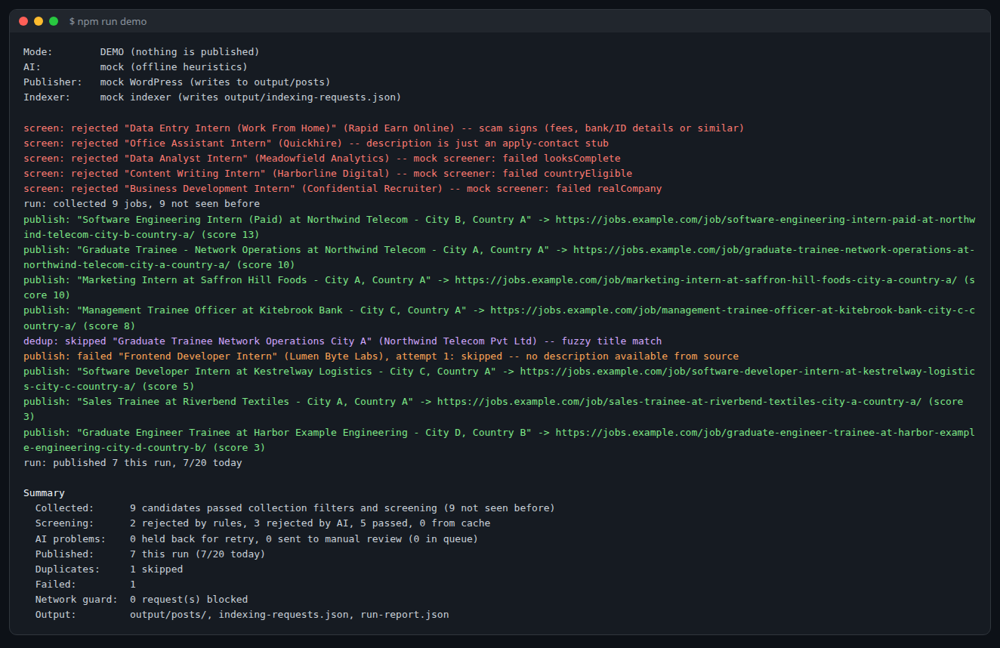

# Automated Job Posting Pipeline

A Node.js project that automatically finds entry-level jobs and internships, filters out bad or fake listings, and publishes them to a job website.

This is a demo version. It runs on sample data and does not publish anything for real.

## How it works

1. **Collect**: reads jobs from company career pages and job-board RSS feeds.
2. **Parse**: pulls out the job title, company, location, description and apply link.
3. **Screen**: removes senior roles, scams and incomplete posts using rules and AI.
4. **Remove duplicates**: skips jobs that were already posted, even if reworded.
5. **Rank**: picks the most useful jobs first.
6. **Generate content**: writes an SEO-friendly job page.
7. **Publish**: posts the job page (simulated WordPress in the demo).
8. **Notify search engines**: submits the new page for indexing (simulated in the demo).
9. **Handle errors**: retries failed jobs and sends problem jobs for manual review.

## Features

- AI screening that never lets a job through if the AI check fails
- Duplicate detection across different sources
- Smart ranking and daily posting limits
- Protection against unsafe input (script injection, fake links, prompt injection)
- Safe demo mode: nothing is really published
- 47 automated tests

## Tech stack

Node.js · AI integration (Groq) · WordPress REST API and Google Indexing API (opt-in adapters) · Node test runner

## Run it

Requires Node.js 22+. No packages to install.

```bash
npm run demo    # run the pipeline on sample data
npm test        # run the tests
```

Results are saved in the `output/` folder: generated job pages, the indexing requests and a run report. Example output is in [`docs/examples/`](docs/examples/), and the design is explained in [`docs/architecture.md`](docs/architecture.md).

## Demo output

One run on the sample data: scams, senior roles, vague and incomplete listings are rejected, a reworded duplicate is skipped, and 7 jobs are published.



A job page generated from a job-board listing:


## Author

**Ahsan Baig Chughtai** · [GitHub](https://github.com/abchughtai786)
